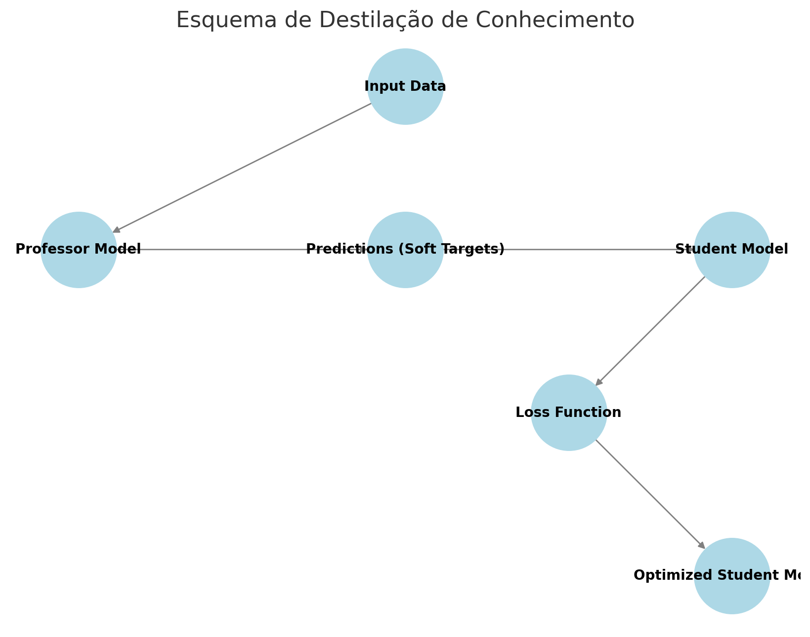

# Knowledge Distillation Experiments

Experiments exploring **teacher-student (professor-aluno) knowledge distillation**: training a smaller "student" neural network to mimic the outputs of a larger "teacher" network, using BERT tokenization to turn text prompts into numeric input.

## Projects in this folder

### 1. `professor_student_distillation.py`
A full teacher-student distillation pipeline on the `Goastro/mlx-grpo-dataset` dataset:
- Loads train/valid/test splits directly from Hugging Face (Parquet format) and lower-cases/strips the `prompt`/`answer` text
- Tokenizes prompts and answers with `bert-base-uncased`, converting them into fixed-length numeric tensors
- Defines a simple two-layer fully connected network (`SimpleNN`) and instantiates two copies: a **professor model** (1500 hidden units) and a smaller **student model** (5000 hidden units in this version, configurable)
- Trains the student to minimize the MSE between its output and the professor's output (the classic distillation loss), with periodic validation

**Note:** this script does not apply reinforcement learning on top of the GRPO-style dataset (documented in the original comments); it only distills from the professor's raw output.

**Requirements:** `torch`, `transformers`, `pandas`. A GPU is strongly recommended (falls back to CPU automatically).

### 2. `distillation_bert_tokens.py`
A lighter, cleaner variant of the same idea: trains a student network (half the hidden size of the teacher) to replicate the teacher's output on BERT-tokenized prompts from the same dataset, with explicit `train_distillation()`, `validate_model()`, and `test_model()` steps and loss reporting at each stage.

**Requirements:** `torch`, `transformers`, `pandas`.

### 3. `distillation_schema.png`
A diagram illustrating the general knowledge distillation flow used by both scripts: Input Data → Professor Model → Predictions (Soft Targets) → Student Model → Loss Function → Optimized Student Model.
